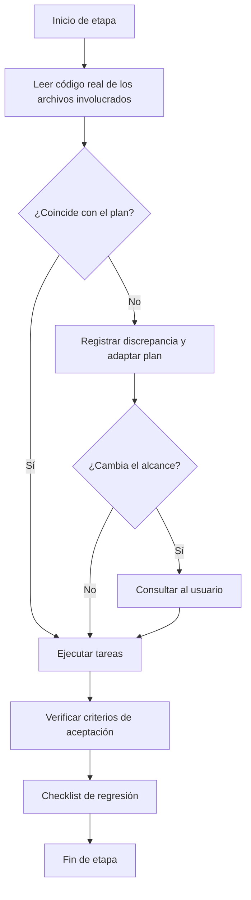
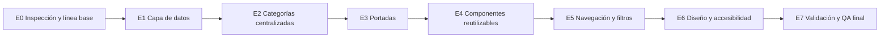

# 02 — Plan de Refactorización del Portafolio React

> **Documento 2 de 3.** Ruta de implementación. Depende de `01-auditoria-y-arquitectura.md` (diagnóstico y arquitectura) y alimenta a `03-skill-integracion-de-proyectos.md`.

---

## 0. ⚠️ REGLA PREVIA OBLIGATORIA: REVISAR EL CÓDIGO ANTES DE EJECUTAR

**El agente de programación NO puede ejecutar ninguna etapa de este plan sin haber revisado antes el código real del repositorio.**

Este plan fue elaborado sin acceso al código. Los archivos, componentes y estructuras citados con marca **[PROPUESTO]** o **[VERIFICAR]** son hipótesis. Antes de **cada etapa** el agente debe:

1. **Leer** los archivos que la etapa indica revisar (y los que descubra relevantes).
2. **Confirmar o corregir** las hipótesis del plan contra lo que realmente existe.
3. **Registrar** discrepancias en la sección 14 del documento 01.
4. **Adaptar** la etapa a la estructura real (nombres, rutas, tecnologías) antes de modificar nada.
5. **Detenerse y preguntar al usuario** si la discrepancia cambia el alcance de la etapa.

> **Ejecutar sin revisar el código previamente es una violación de este plan.**

---

## 1. Objetivo general

Evolucionar el portafolio React existente hacia una plataforma modular, escalable y mantenible, donde agregar un proyecto consista en **añadir un objeto de datos y una portada**, sin modificar componentes.

## 2. Principios de trabajo

1. Revisar antes de modificar.
2. No reconstruir desde cero; no eliminar funcionalidades sin justificación.
3. Cambios pequeños, verificables y reversibles (un commit por tarea lógica).
4. Mantener la identidad visual existente.
5. Cada cambio resuelve un problema concreto documentado.
6. No instalar dependencias sin justificar (alternativa evaluada, razón, impacto).
7. No inventar datos de proyectos, enlaces, imágenes ni tecnologías.
8. Aplicar la modularización mínima necesaria.
9. Trabajar en una rama dedicada (`refactor/<etapa>`), nunca directamente en la principal.
10. Verificar build y regresión al cierre de cada etapa.

## 3. Estado inicial

**[VERIFICAR]** — Completar en la Etapa 0 con datos reales:

| Aspecto | Valor |
|---|---|
| Commit base | `c3e42852ba640a101d080832e3af1f1e024e1c05` (2026-11-03); la captura de escritorio se compartió el 2026-11-11 |
| Resultado de `build` | Correcto en línea base; repetido tras preparar la galería en E7 |
| Resultado de `lint` (si existe) | Correcto en línea base; repetido tras preparar la galería en E7 |
| Pruebas existentes | No hay pruebas automatizadas configuradas |
| Nº de proyectos reales publicados | 0; los seis objetos iniciales eran relleno y el usuario pidió retirarlos |
| Dónde viven hoy los datos | `src/data/projects.js`; categorías centralizadas en `src/data/categories.js` desde E2 |

## 4. Arquitectura de destino

Ver `01-auditoria-y-arquitectura.md`, secciones 9–13. Resumen **[PROPUESTO]**:

- `src/data/categories.js` y `src/data/projects.js` como única fuente de verdad.
- `ProjectCard`, `ProjectGrid`, `ProjectFilters` reutilizables.
- Resolución de portadas por convención de nombre con *placeholder*.

---

## 5. Etapas de implementación

> Cada etapa incluye como **primera tarea** la revisión de código descrita en la sección 0.

### Etapa 0 — Inspección y línea base

| Campo | Contenido |
|---|---|
| **Objetivo** | Conocer el proyecto real y fijar una línea base verificable |
| **Problema que resuelve** | Evitar planificar y modificar sobre suposiciones |
| **Archivos a revisar** | Todo el repositorio: `package.json`, configuración, `src/**`, `public/**` |
| **Archivos a modificar** | Solo documentación en `docs/plan-refactorizacion/` |
| **Archivos nuevos** | Ninguno de código |
| **Tareas** | 1) Completar checklist del doc. 01 §0.2. 2) Pegar árbol real (§3). 3) Completar tecnologías (§2). 4) Tabla de rutas (§5). 5) Hallazgos con evidencia y prioridad P0–P3 (§8). 6) Ejecutar build/lint/tests y guardar resultado. 7) Capturas de escritorio y móvil. |
| **Orden / dependencias** | Primera etapa; bloquea a todas las demás |
| **Explicación técnica** | Sin línea base no se puede demostrar ausencia de regresiones |
| **Resultado esperado** | Documento 01 completado con datos reales y discrepancias registradas |
| **Criterios de aceptación** | Cada hallazgo cita archivo real; no quedan marcas [VERIFICAR] sin resolver en los apartados usados por la etapa 1 |
| **Pruebas** | `build` exitoso en la línea base (o fallo documentado como P0) |
| **Riesgos** | Entorno no reproducible; mitigar documentando versión de Node |
| **Verificación de no-daño** | No hay cambios en `git diff` fuera de `docs/` |

**Checklist E0**
- [x] Código revisado
- [x] Documento 01 actualizado
- [x] Línea base registrada
- [x] Usuario informado de discrepancias relevantes
- [x] Captura de escritorio revisada (aportada por el usuario)
- [ ] Captura móvil revisada (pendiente; permiso de origen local denegado)

---

### Etapa 1 — Capa de datos de proyectos

| Campo | Contenido |
|---|---|
| **Objetivo** | Separar los datos de proyectos de los componentes visuales |
| **Problema que resuelve** | Datos incrustados en JSX **[VERIFICAR si ocurre]**; imposibilidad de agregar proyectos sin tocar UI |
| **Revisar** | Componentes que hoy renderizan proyectos y donde se definen sus datos (rutas reales) |
| **Modificar** | Los componentes que contengan datos incrustados (se identifican en E0) |
| **Nuevos [PROPUESTO]** | `src/data/projects.js` |
| **Tareas** | 1) Revisar la forma actual de los proyectos. 2) Definir el esquema final con base en el código y los datos solicitados por el usuario. 3) Migrar exactamente los proyectos reales; si el usuario confirma que son relleno, retirarlos sin reemplazarlos con contenido ficticio. 4) Hacer que los componentes lean de `projects.js`. 5) Eliminar datos duplicados solo tras verificar equivalencia. |
| **Dependencias** | E0 |
| **Explicación técnica** | Una sola fuente de datos permite listar, filtrar y validar |
| **Resultado esperado** | La UI se ve idéntica, pero los datos viven en `data/` |
| **Aceptación** | Se conservan todas las fichas reales confirmadas; los datos de relleno identificados por el usuario no se publican. |
| **Pruebas** | Comparación visual antes/después; build; conteo de tarjetas |
| **Riesgos** | Pérdida de campos al migrar; mitigar con comparación campo a campo |
| **No-regresión** | Capturas comparadas; todos los enlaces previos siguen funcionando |

**Checklist E1**
- [x] Código revisado antes de editar
- [x] Se retiraron los seis objetos que el usuario confirmó como relleno; el arreglo queda listo para datos reales
- [x] Componentes sin datos incrustados
- [x] Build OK

---

### Etapa 2 — Categorías centralizadas

| Campo | Contenido |
|---|---|
| **Objetivo** | Registrar categorías en un único lugar |
| **Problema que resuelve** | Categorías definidas de forma dispersa o duplicada **[VERIFICAR]** |
| **Revisar** | Cómo se agrupan/etiquetan hoy los proyectos en la UI |
| **Modificar** | Componentes que dependan de nombres de categoría escritos a mano |
| **Nuevos [PROPUESTO]** | `src/data/categories.js` |
| **Tareas** | 1) Reconciliar las cuatro categorías del proyecto con lo existente. 2) Crear el registro (id, nombre, institución, descripción, orden). 3) Hacer que cada proyecto referencie `category` por id. 4) Añadir validación de categoría existente (función o chequeo en desarrollo). |
| **Dependencias** | E1 |
| **Explicación técnica** | Agregar una categoría debe ser añadir un objeto, no editar componentes |
| **Resultado esperado** | Todos los proyectos asociados a una categoría válida |
| **Aceptación** | Ningún proyecto con categoría inexistente; el orden de categorías se controla desde datos |
| **Pruebas** | Validación automática o script de comprobación; revisión visual |
| **Riesgos** | Cambios de `id` rompen referencias; mitigar con búsqueda global antes de renombrar |

**Checklist E2**
- [x] Código revisado
- [x] `categories.js` creado y usado
- [x] Validación de categoría presente y activa
- [x] Build OK

---

### Etapa 3 — Sistema de portadas

| Campo | Contenido |
|---|---|
| **Objetivo** | Asociar portadas por convención de nombre, con *placeholder* |
| **Problema que resuelve** | Referencias a imágenes manuales y frágiles; imágenes faltantes que rompen la UI **[VERIFICAR]** |
| **Revisar** | Cómo se cargan hoy las imágenes y dónde están los archivos |
| **Modificar** | Componente de tarjeta/listado que muestra la imagen |
| **Nuevos [PROPUESTO]** | `src/utils/resolveCover.js`; directorio de portadas; *placeholder* neutro |
| **Tareas** | 1) Decidir ubicación según el bundler real. 2) Definir convención `<id>.<ext>`. 3) Implementar `resolveCover(id)` con fallback. 4) Agregar `alt` accesible y carga diferida. 5) Documentar formato, proporción y peso recomendados. |
| **Dependencias** | E1 |
| **Explicación técnica** | La convención evita rutas manuales; el fallback evita imágenes rotas |
| **Resultado esperado** | Proyectos sin portada muestran un *placeholder* sin errores |
| **Aceptación** | Cero imágenes rotas; `alt` presente en todas las portadas |
| **Pruebas** | Probar con un proyecto sin imagen; revisar consola; revisión de red |
| **Riesgos** | Diferencias entre desarrollo y producción en rutas de imágenes; probar `build` y vista previa |
| **Restricción** | No generar ni modificar imágenes |

**Checklist E3**
- [x] Código revisado
- [x] Convención documentada (`public/projects/<id>.<ext>`)
- [x] Fallback visual implementado
- [x] Build OK
- [ ] Preview visual pendiente del gate de origen denegado

---

### Etapa 4 — Componentes reutilizables

| Campo | Contenido |
|---|---|
| **Objetivo** | Unificar la presentación de proyectos |
| **Problema que resuelve** | Tarjetas o secciones duplicadas por categoría **[VERIFICAR]** |
| **Revisar** | Componentes de tarjeta, sección y listado actuales |
| **Modificar** | Componentes duplicados o demasiado grandes (solo los comprobados) |
| **Nuevos [PROPUESTO]** | `ProjectCard`, `ProjectGrid`, `CategorySection` en `src/components/projects/` |
| **Tareas** | 1) Extraer la tarjeta existente conservando su diseño. 2) Parametrizar por props. 3) Reemplazar duplicados. 4) Dividir solo componentes realmente sobredimensionados. |
| **Dependencias** | E1, E2, E3 |
| **Explicación técnica** | Un único componente reduce errores y facilita cambios de diseño |
| **Resultado esperado** | Todas las categorías usan los mismos componentes |
| **Aceptación** | Sin componentes duplicados para presentar proyectos; apariencia equivalente |
| **Pruebas** | Comparación visual; build; revisión de props |
| **Riesgos** | Sobre-modularización; limitar a lo necesario |

**Checklist E4**
- [x] Código revisado
- [x] Una `ProjectCard` compartida para todos los proyectos
- [x] Build OK
- [ ] Comparación visual nueva en escritorio/móvil pendiente

---

### Etapa 5 — Navegación y filtros

| Campo | Contenido |
|---|---|
| **Objetivo** | Permitir explorar proyectos por categoría |
| **Problema que resuelve** | Dificultad para navegar al crecer el listado |
| **Revisar** | Sistema de navegación y rutas actuales |
| **Modificar** | Página/sección principal de proyectos |
| **Nuevos [PROPUESTO]** | `ProjectFilters`; hook `useProjectFilters` **solo si** hay lógica reutilizable |
| **Tareas** | 1) Filtro por categoría. 2) Conservar rutas existentes. 3) Estado vacío ("sin proyectos"). 4) Búsqueda solo si se justifica (P3). |
| **Dependencias** | E2, E4 |
| **Aceptación** | Filtro funcional; rutas previas siguen funcionando |
| **Pruebas** | Navegación manual; recarga directa de rutas; teclado |
| **Riesgos** | Romper rutas o enlaces compartidos existentes |

**Checklist E5**
- [x] Código revisado
- [x] Filtros y estado vacío preparados; no hay rutas previas fuera de `/`
- [x] Ruta `/` intacta

---

### Etapa 6 — Diseño y accesibilidad

| Campo | Contenido |
|---|---|
| **Objetivo** | Mejorar consistencia visual y accesibilidad sin rediseñar |
| **Problema que resuelve** | Inconsistencias detectadas en E0 (colores, espaciado, contraste, móvil) |
| **Revisar** | Sistema de estilos real y capturas de E0 |
| **Modificar** | Estilos y componentes con hallazgos documentados |
| **Tareas** | 1) Centralizar tokens (colores, tipografía, espaciado) en el mecanismo de estilos existente. 2) Corregir contraste y foco visible. 3) Verificar responsividad. 4) Semántica HTML y `alt`. |
| **Dependencias** | E4 |
| **Aceptación** | Contraste adecuado, navegación por teclado, sin desbordes en móvil |
| **Pruebas** | Revisión manual en móvil y escritorio; herramienta de accesibilidad del navegador |
| **Riesgos** | Cambiar la identidad visual; mantener paleta y estilo actuales |

**Checklist E6**
- [x] Código revisado
- [x] Paleta lila/índigo conservada
- [x] Foco, etiquetas de botones, `alt`, `lang` y skip link revisados en código
- [ ] Vista móvil revisada visualmente

---

### Etapa 7 — Validación y QA final

| Campo | Contenido |
|---|---|
| **Objetivo** | Cierre verificable del proceso |
| **Tareas** | Build limpio; revisión de consola; verificación de enlaces; verificación de imágenes; responsividad; accesibilidad; revisión de rendimiento; validación de datos; regresión completa |
| **Dependencias** | E1–E6 |
| **Aceptación** | Todas las listas de comprobación en verde |

**Checklist E7**
- [x] Build sin errores
- [x] ESLint sin hallazgos
- [ ] Enlaces de proyectos: no hay datos reales todavía para verificar
- [x] No se muestran imágenes rotas; fallback listo y sin portadas reales cargadas
- [x] Validación de datos activa (lista vacía válida)
- [ ] Regresión visual móvil pendiente
- [x] Documentación actualizada

---

## 6. Estrategia de validación

| Verificación | Cómo |
|---|---|
| Compilación | Script `build` existente |
| Errores | Consola del navegador y lint existente |
| Rutas | Recorrido manual, incluida recarga directa |
| Componentes | Revisión visual; pruebas automatizadas solo si ya existen o se justifican |
| Enlaces | Comprobación manual o script sin dependencias nuevas |
| Imágenes | Revisión de red y consola |
| Responsividad | Anchos típicos de móvil, tableta y escritorio |
| Accesibilidad | Teclado, contraste, `alt`, semántica |
| Rendimiento | Peso de imágenes y tamaño del bundle, solo si hay problema comprobado |
| Datos | Chequeo de campos obligatorios y categorías válidas |

## 7. Control de regresiones

Antes y después de cada etapa:

- [ ] Mismo número de proyectos visibles que en la línea base
- [ ] Mismos enlaces funcionando
- [ ] Mismas rutas respondiendo
- [ ] Apariencia equivalente (comparar capturas)
- [ ] Build exitoso
- [ ] Sin errores nuevos en consola

Si algo falla: **revertir la tarea** (`git revert`/restaurar rama), documentar y consultar al usuario.

## 8. Riesgos generales

| Riesgo | Mitigación |
|---|---|
| Ejecutar sin conocer el código | Sección 0 obligatoria |
| Pérdida de contenido al migrar datos | Comparación campo a campo |
| Sobre-ingeniería | Principio de modularización mínima |
| Dependencias innecesarias | Justificación previa |
| Romper enlaces/rutas existentes | Pruebas de ruta y regresión |

## 9. Checklist general de finalización

- [ ] Código revisado antes de cada etapa
- [ ] Documento 01 sin marcas [VERIFICAR] pendientes
- [ ] Datos de proyectos solo en `data/`
- [ ] Categorías centralizadas y validadas
- [ ] Portadas por convención con *placeholder*
- [ ] Componentes sin duplicación
- [ ] Filtros funcionando
- [ ] Accesibilidad y responsividad verificadas
- [ ] Skill de integración (doc. 03) probada con un proyecto de ejemplo real aportado por el usuario
- [ ] Usuario aprobó el resultado

---

## 10. Orden recomendado de inicio

1. **E0** (obligatoria, sin tocar código).
2. Presentar al usuario el resumen de hallazgos y esperar su **autorización**.
3. Continuar con E1 → E7 en orden, una etapa por vez, con aprobación en puntos críticos.
