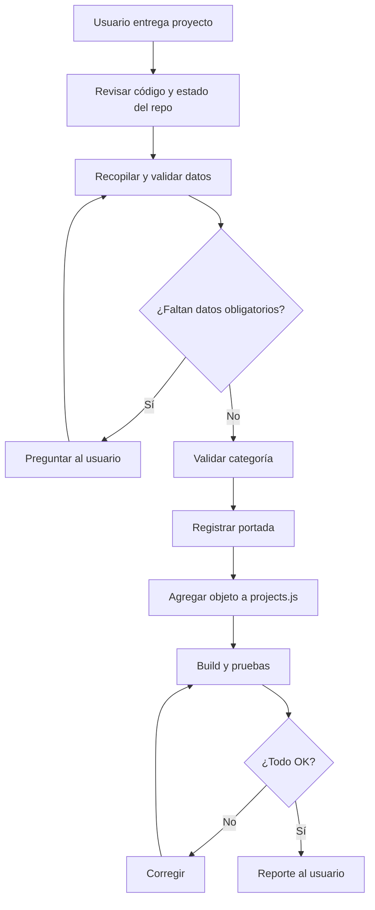

# Skill — Integración de proyectos al portafolio

> **Documento 3 de 3.** Skill operativa reutilizable. Depende de la arquitectura definida en `01-auditoria-y-arquitectura.md` y de que las etapas E1–E4 de `02-plan-de-refactorizacion.md` estén completadas.

---

## 0. ⚠️ REVISIÓN OBLIGATORIA DEL CÓDIGO ANTES DE ACTUAR

**Antes de integrar cualquier proyecto, el agente DEBE revisar el código actual del repositorio.** No se puede confiar solo en este documento: la estructura pudo cambiar desde que se escribió.

Pasos obligatorios al inicio de **cada sesión**:

1. Leer `src/data/categories.js` y `src/data/projects.js` (o los archivos equivalentes reales **[VERIFICAR]**).
2. Revisar el componente de tarjeta y el de listado que se usan realmente.
3. Verificar dónde se almacenan las portadas y cómo se resuelven.
4. Ejecutar `git status` para conocer el estado del trabajo.
5. Si la estructura real difiere de este documento: **prevalece el código**; registrar la diferencia y adaptar el procedimiento.
6. Si la capa de datos aún no existe (etapas E1–E4 sin completar), **detenerse** e informar al usuario: esta Skill no debe usarse para incrustar datos en componentes.

> Rutas de este documento marcadas **[PROPUESTO]** pueden no existir. Confirmarlas antes de usarlas.

---

## 1. Descripción y objetivo

Integrar un nuevo proyecto al portafolio de forma **simple, repetible y segura**, reutilizando la arquitectura existente, sin duplicar componentes ni inventar información.

## 2. Contexto del portafolio

- Portafolio profesional desarrollado con React.
- Autor: Licenciado en Matemáticas (UPN), estudiante de Ingeniería de Sistemas (Areandina), formación SENA.
- Los proyectos se organizan por categorías y se presentan mediante tarjetas con portada, descripción y enlace.
- La información de los proyectos vive en una **capa de datos** separada de los componentes visuales.

## 3. Categorías disponibles

> Los ids vigentes se mantienen en `src/data/categories.js`.

| `id` | Categoría | Contenido |
|---|---|---|
| `upn` | Universidad Pedagógica Nacional — Docencia | Proyectos de docencia y formación |
| `sena` | Emprendimientos SENA | Emprendimientos y proyectos formativos |
| `personales` | Proyectos personales | Proyectos e iniciativas personales |
| `areandina` | Areandina — Ingeniería de Sistemas | Proyectos del área de Ingeniería de Sistemas |

Si el usuario indica una categoría que no está en el registro, **no la inventes**: sigue la sección 12.

---

## 4. Procedimiento para recibir un nuevo proyecto



### 4.1 Datos que el usuario proporciona

| Dato | Obligatorio | Origen |
|---|---|---|
| Nombre del proyecto | ✅ | Usuario |
| Categoría | ✅ | Usuario |
| Enlace del proyecto | ✅ | Usuario |
| Imagen de portada (identificada con el nombre del proyecto) | Recomendada | Usuario |
| Descripción | ✅ | Usuario |
| Repositorio | ⛔ opcional | Usuario |

**Regla:** solo se registra lo que el usuario entregó. Está prohibido inventar descripciones, fechas o características. La descripción es necesaria para publicar una tarjeta.

---

## 5. Estructura de datos

Esquema **[PROPUESTO]** (confirmar contra el existente; conservar nombres de campo reales si ya difieren):

```js
{
  id: "kebab-case-unico",       // obligatorio
  title: "Nombre visible",      // obligatorio
  category: "id-de-categoria",  // upn, sena, personales o areandina
  description: "...",           // obligatorio; texto entregado por el usuario
  url: "https://...",           // obligatorio; sitio del proyecto
  cover: "/projects/id.webp",   // opcional; imagen en public/projects/
  coverAlt: "...",              // opcional
  repoUrl: "https://...",       // opcional; repositorio
}
```

---

## 6. Convenciones de nombres

| Elemento | Regla | Ejemplo (forma, no dato real) |
|---|---|---|
| `id` | kebab-case, minúsculas, sin tildes, sin espacios, único | `mi-proyecto` |
| Archivo de portada | `<id>.<ext>` | `mi-proyecto.webp` |
| Categoría | `id` del registro | `upn`, `sena`, `personales` o `areandina` |
| Etiquetas | minúsculas, sin tildes | `educacion` |

Conversión del nombre al `id`: minúsculas → quitar tildes → espacios a guiones → quitar caracteres especiales. Confirmar que el `id` resultante **no exista ya** en `projects.js`.

---

## 7. Organización y registro de portadas

| Aspecto | Regla |
|---|---|
| Ubicación | `public/projects/` |
| Nombre | `<id>.webp`, `<id>.jpg` o `<id>.png`; el campo `cover` usa `/projects/<id>.<ext>` |
| Formato recomendado | WebP (JPG/PNG aceptables) |
| Proporción | La usada por la tarjeta actual (sugerida 16:9) |
| Peso objetivo | < 200 KB |

**Procedimiento:**

1. Localizar la imagen que el usuario subió.
2. Confirmar que su nombre corresponde al proyecto (si hay duda, preguntar).
3. Renombrarla/ubicarla según la convención **sin modificar su contenido**.
4. Registrar la ruta en `cover` y confirmar que el archivo abra.
5. Si no hay imagen, la tarjeta muestra un *placeholder* neutral.

**Prohibido:** generar imágenes, recortarlas o alterarlas sin que el usuario lo pida.

---

## 8. Incorporación de enlaces

1. Debe ser una URL completa (`https://...`).
2. Si es posible, verificar que responde (por ejemplo, `curl -I <url>` o apertura manual). Si el entorno no permite acceso, **indicarlo** en el reporte en vez de afirmar que funciona.
3. No modificar la URL entregada.
4. Los enlaces externos deben abrirse con `target="_blank"` y `rel="noopener noreferrer"` si así lo hace ya el componente existente.

---

## 9. Actualización de la capa de datos

1. Abrir `src/data/categories.js` y `src/data/projects.js` y revisar el formato vigente.
2. Agregar **un único objeto** al arreglo `projects` en `src/data/projects.js`.
3. Completar solo los campos entregados.
4. No tocar los demás proyectos.
5. No modificar componentes visuales.

---

## 10. Validación de categorías

- [ ] La categoría existe en `categories.js`.
- [ ] Se escribió exactamente igual que su `id`.
- [ ] Si no existe: **no crear automáticamente**; preguntar al usuario si desea agregarla (ver sección 12).

---

## 11. Uso de componentes existentes

- Usar `ProjectCard`/`ProjectGrid`/`CategorySection` reales **[VERIFICAR nombres]**.
- No crear una página nueva por proyecto.
- No duplicar componentes ni copiar una tarjeta para un caso especial.
- Si el proyecto necesita un campo nuevo, **primero** proponer al usuario ampliar el esquema y ajustar el componente compartido, en lugar de crear uno paralelo.

### Reglas de modularización
- Un solo origen de datos.
- Componentes presentacionales sin datos incrustados.
- Lógica reutilizable en hooks/utilidades solo si realmente se repite.

### Reglas para evitar duplicación
- Buscar antes de crear (`grep` por nombre de componente/clase).
- Reutilizar tokens y estilos existentes.

### Reglas de diseño
- Mantener la identidad visual del portafolio.
- Misma jerarquía y estilo de tarjeta para todas las categorías.
- Campos opcionales ausentes → se omiten sin dejar huecos visuales.
- Textos alternativos accesibles para las portadas.

---

## 12. Manejo de información faltante

| Situación | Acción del agente |
|---|---|
| Falta nombre, categoría o enlace | Preguntar antes de continuar |
| Falta portada | Usar *placeholder*, avisar al usuario |
| Falta descripción | No publicar la tarjeta hasta que el usuario la proporcione; **no inventar** |
| Categoría inexistente | Preguntar si se debe crear; si sí, agregarla en `categories.js` con datos que el usuario confirme |
| Imagen con nombre ambiguo | Preguntar a qué proyecto corresponde |
| `id` duplicado | Informar y proponer alternativa |
| Enlace no verificable | Registrar y avisar que no se pudo comprobar |

---

## 13. Pruebas posteriores a la integración

- [ ] Compilación exitosa (`build`).
- [ ] Sin errores nuevos en consola.
- [ ] El proyecto aparece en su categoría correcta.
- [ ] La portada correcta se asocia al proyecto correcto.
- [ ] El enlace abre el destino esperado (o se informó que no se pudo verificar).
- [ ] Visualización correcta en escritorio y móvil.
- [ ] Los proyectos previos siguen apareciendo igual (conteo antes/después).
- [ ] Filtros y navegación siguen funcionando.
- [ ] Accesibilidad básica (`alt`, foco, contraste).

## 14. Criterios de aceptación

Un proyecto está correctamente integrado cuando:

1. Existe **un solo objeto nuevo** en la capa de datos, con `id` único y categoría válida.
2. No se modificaron componentes ni datos de otros proyectos.
3. La portada está registrada por convención (o usa *placeholder* declarado).
4. Ningún dato fue inventado.
5. El build y las pruebas pasan.
6. El usuario recibió un reporte claro con lo hecho y lo pendiente.

## 15. Checklist de integración

- [ ] Código y estado del repositorio revisados al iniciar la sesión
- [ ] Datos obligatorios completos
- [ ] `id` generado y verificado como único
- [ ] Categoría validada
- [ ] Portada ubicada con el nombre correcto (o *placeholder*)
- [ ] Enlace incorporado y verificado cuando fue posible
- [ ] Objeto agregado a `projects.js`
- [ ] Sin cambios en componentes ni en otros proyectos
- [ ] Build OK
- [ ] Revisión en escritorio y móvil
- [ ] Reporte entregado al usuario

---

## 16. Instrucciones para el agente en futuras sesiones

1. **Revisa siempre el código primero** (sección 0). No asumas.
2. Pide solo los datos que falten; no repitas preguntas ya respondidas.
3. Trabaja en una rama o con commits pequeños y descriptivos (ej. `feat(proyectos): agregar <id>`).
4. Nunca elimines ni reordenes proyectos existentes sin que el usuario lo pida.
5. Nunca inventes contenido.
6. No instales dependencias para esta tarea.
7. Si la estructura real no coincide con este documento, **actualiza este documento y el 01** y avisa al usuario.
8. Cierra cada sesión con un reporte.

### Plantilla de reporte final

```md
## Integración completada: <nombre>
- id: <id>
- Categoría: <categoría>
- Enlace: <url> — verificado: sí / no (motivo)
- Portada: <archivo> / placeholder
- Campos completados: <lista>
- Campos pendientes (no entregados): <lista>
- Archivos modificados: <rutas reales>
- Pruebas: build ✅/❌ · escritorio ✅/❌ · móvil ✅/❌ · regresión ✅/❌
- Observaciones: <...>
```
